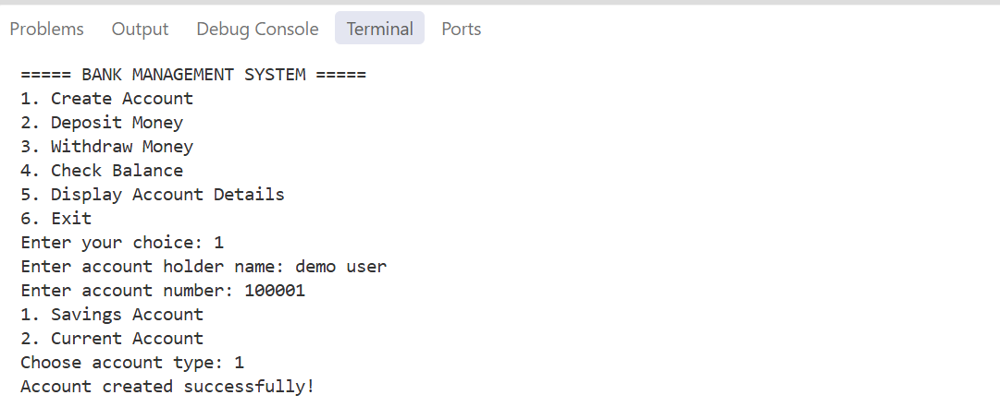

# 🏦 Bank Management System

A console-based Bank Management System developed using Python and Object-Oriented Programming (OOP) concepts.

This project allows users to create bank accounts, deposit money, withdraw money, check account balances, and view account details through an interactive menu-driven interface.

## 🚀 Features

- Create Savings and Current Bank Accounts
- Deposit Money
- Withdraw Money
- Check Account Balance
- Display Account Details
- Prevent Duplicate Account Numbers
- Validate Deposit and Withdrawal Amounts
- Handle Insufficient Balance
- Interactive Menu-Driven Interface

## 🛠️ Technologies Used

- Python 3
- Object-Oriented Programming (OOP)

## 🧠 OOP Concepts Implemented

- **Classes and Objects:** Used to organize bank account and banking operations.
- **Inheritance:** SavingsAccount and CurrentAccount inherit from BankAccount.
- **Encapsulation:** Account balance is stored using a private attribute.
- **Abstraction:** Abstract BankAccount class defines the account type interface.
- **Polymorphism:** Different account classes implement their own account_type() method.

## 📂 Project Structure

```text
Bank-Management-System/
│
├── bms.py
└── README.md
```

## ⚙️ How to Run the Project

1. Clone this repository:

```bash
git clone https://github.com/Harshitha-Vaddella/Bank-Management-System.git
```

2. Open the project folder:

```bash
cd Bank-Management-System
```

3. Run the Python file:

```bash
python bms.py
```

## 📋 Application Menu

```text
===== BANK MANAGEMENT SYSTEM =====

1. Create Account
2. Deposit Money
3. Withdraw Money
4. Check Balance
5. Display Account Details
6. Exit
```

## 🎯 Project Objective

The main objective of this project is to apply Python programming and Object-Oriented Programming concepts to develop a simple banking application with basic account management and transaction operations.

## 👩‍💻 Author

**Harshitha Vaddella**

GitHub: [Harshitha-Vaddella](https://github.com/Harshitha-Vaddella)


## 📸 Project Screenshot

